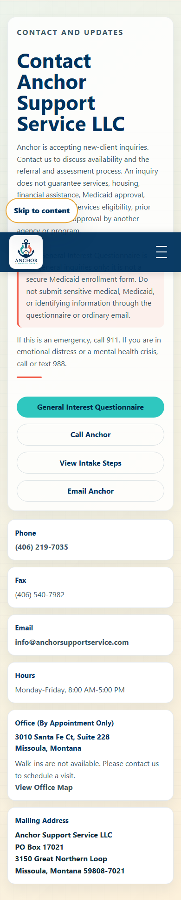
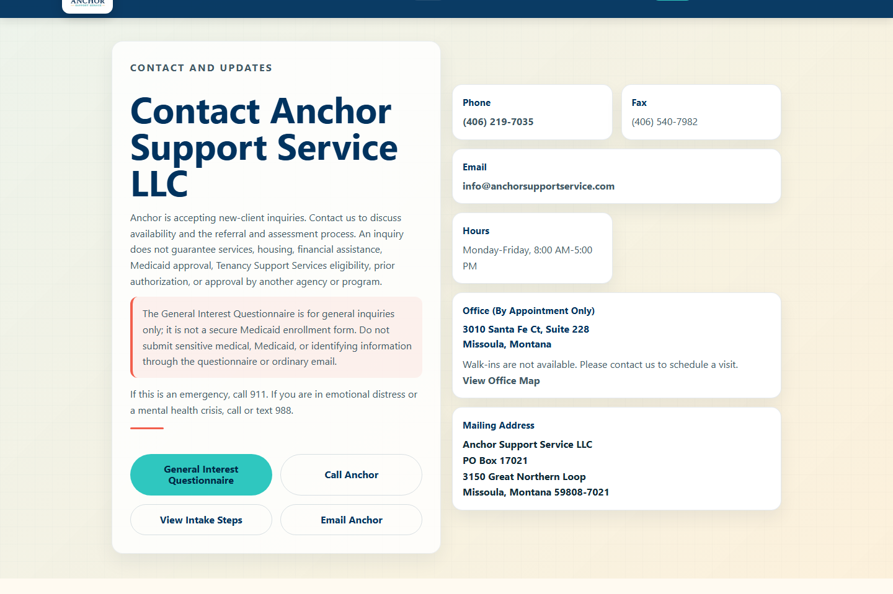
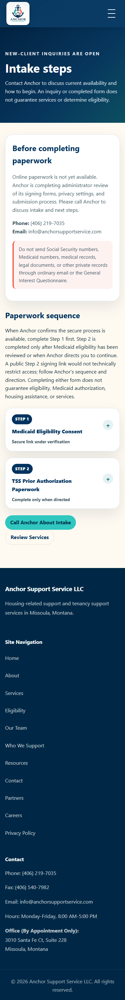

# Anchor Intake and Partners Release Review

**Branch:** `phase2/partners`  
**Target:** `main`  
**State:** Telephone and general-interest inquiry release prepared on this branch. Secure online intake remains inactive. No PR was created because the connected GitHub integration rejected PR creation with HTTP 403 (`Resource not accessible by integration`). Do not merge or deploy without owner approval.

## Integrated history

This branch preserves the current main baseline and prior work in its ancestry:

- `dee39e3` — current main baseline, including Careers/Indeed recruitment updates.
- `bf3afc0` — Phase 1 static-site modernization, allowlisted Pages publishing, and QA workflow.
- `4be833e` — Phase 2 intake reopening copy and telephone fallback, with unverified signing forms withheld.
- `db1ec4e` — Partners page, site navigation, sitemap, allowlist, and QA coverage.

No old intake-pause notice was restored. Careers and Indeed links and the deployment allowlist remain intact.

## Partners page

The `/partners/` route covers landlord and property-manager coordination, tenant communication and housing stability, eviction-risk coaching and referrals, legal/financial limits, confidentiality and authorization, existing contact information, and “Additional Partnership Resources Coming Soon.” It adds no form, client database, or backend. The contact path is the existing phone and general email, expressly for general partnership inquiries; confidential client details are not requested by ordinary email.

The page makes support conditional on eligibility, the client’s service plan, authorization, and program requirements. It does not promise eviction prevention, tenant compliance, rental payments, funding, placement, or service eligibility. It states that Anchor does not provide legal advice or representation and landlords need not waive lawful standards.

## Jotform readiness: blocked pending administrator verification

The two historical forms are:

1. **Anchor Medicaid Eligibility Consent**
2. **TSS PA / Referral Paperwork**

The `/secure-paperwork.html` page provides verified telephone contact and clearly states that online paperwork is not yet available. The homepage Contact section now offers the existing Google General Interest Questionnaire alongside the phone and intake-steps actions, states it is not a secure Medicaid enrollment form, and warns against submitting sensitive medical, Medicaid, or identifying information. The form's public blank view asks for contact information and general housing/service needs, explicitly prohibits Social Security numbers, medical records, legal documents, full Medicaid numbers, and private documents, and provides a submit control. On November 18, 2026, it loaded successfully (HTTP 200), showed a Submit control, and displayed no closed-form message. No data was entered or submitted. This indicates the form appeared open at check time, but does not verify response routing or notifications.

The intake page retains the Step 1 Medicaid Consent then Step 2 TSS Referral / Prior Authorization sequence, with Step 2 only after Medicaid review or Anchor's direction. No Jotform embed, invitation link, or full-screen signing link is included in current website source or generated public output. Online signing remains inactive.

An earlier anonymous read-only check observed some non-empty fields in the supplied forms. **That observation alone is not evidence of a privacy incident. No field contents were inspected, exposed, recorded, or submitted.** The authorized Jotform administrator must determine whether any prefilled content is an intentional organization-level default or applicant-specific information by inspecting form configuration in the authenticated account and confirming with safe synthetic sessions only. No actual applicant values should be copied into this review or shared during verification.

An authorized Jotform administrator must verify and document all of the following before enabling online paperwork:

1. In the live account, confirm both forms are active and obtain current reusable public Share → Embed URLs, not invitation-specific links. Verify fresh sessions are separate and do not expose prior applicants' information. Use synthetic data only. Do not publish these URLs until confirmed reusable and safe.
2. Review these field categories in the form configuration and confirm their defaults are organization-level and contain no applicant-specific information: organization identity and contact fields; applicant identity and contact fields; date-of-birth and Medicaid/member identifiers; referral, provider, service, and prior-authorization details; health, eligibility, and case information; signatures, dates, and attestations; uploaded files or attachments.
3. Verify a current, executed HIPAA Business Associate Agreement applies to Anchor’s Jotform account, plan, forms, storage, and enabled features. Confirm which submissions and attachments it covers; do not infer coverage from a product label or a generic vendor statement.
4. Review submission privacy and separation: who can view, edit, export, download, or share each form’s responses; whether responses or attachments appear in public/shared locations; and whether access is limited to the correct authorized staff.
5. Review account access: current named staff, role permissions, authentication/MFA settings, former-staff access removal, and available access/audit history.
6. Review notifications and routing: send only minimum-necessary notifications, avoid PHI in ordinary email subjects/bodies and attachments, confirm recipients are authorized, and keep the consent and TSS PA workflows separate and correctly ordered.
7. Confirm retention, deletion, export/backups, and incident/escalation procedures for the submissions under Anchor’s applicable policies and agreements.
8. Only after the preceding checks, use synthetic data to verify signing, separate sessions, notifications, routing, authorized access, and deletion. Do not enter actual client PHI during testing.

Official Jotform guidance describes generating a Jotform Sign embed via **Share → Embed**, but only the account administrator can confirm the actual reusable link and account configuration. Jotform's HIPAA help describes account-level HIPAA environment and BAA checks; Anchor's own configuration and signed BAA remain unverified ([Jotform Sign embed instructions](https://www.jotform.com/help/how-to-use-jotform-sign/), [HIPAA BAA instructions](https://www.jotform.com/help/501-how-to-receive-the-baa-for-my-hipaa-account/), [HIPAA environment setup](https://www.jotform.com/help/500-how-to-enable-hipaa-compliance/)).

Until administrator verification is complete, the public secure-paperwork route offers a clearly labeled **Call Anchor About Intake** telephone option. It shows no online application button, does not claim that online paperwork is active, and remains `noindex, nofollow`. The review branch supports telephone and general-interest inquiries; the live website has not been updated.

## Verification results

Ran the public-site builder and existing Playwright QA suite against `dist/public-site` after adding `/partners/` to the explicit allowlist.

- 60 page/viewport combinations across 360, 375, 390, 430, 768, 900, 1024, 1366, 1440, and 1920 px; 13 expected external links including the Google questionnaire.
- No overflow, page errors, console errors, failed local requests, broken images, unresolved internal links, or automated accessibility smoke-test findings.
- Partners content/limitations/privacy/contact/no-form checks passed; route is in the sitemap, public allowlist, homepage callout, mobile navigation, desktop navigation, footer, Careers, Policy, secure-paperwork, and 404 navigation.
- Existing client-intake phone fallback, Careers/Indeed/PDF, Privacy Policy, contact links, and public WaiverTrack landing-route checks passed. WaiverTrack authentication was not opened or changed.
- Secure-paperwork QA verifies the forms-unavailable notice, telephone contact, sequence, no-guarantee notice, `noindex, nofollow`, no form/iframe, and no Jotform or invitation links in the current public page source/output.
- Homepage Contact QA verifies the General Interest Questionnaire URL and visible label, phone and intake-steps actions, safe-link attributes, and the notice that this is not secure Medicaid enrollment and must not receive sensitive data.
- The form status, default field categories, fresh-session isolation, destination account, notification contents/recipients, staff access, HIPAA environment, and BAA coverage require authorized administrator verification.
- Pre-deployment live check on November 18, 2026: homepage HTTP 200 but still contains the intake-pause wording; `/partners/` returns HTTP 404; `/careers/` returns HTTP 200. The live homepage already has the existing General Interest List form link. These are baseline observations before this branch is merged or deployed, not post-deployment verification.
- No real client data was used; no Jotform was submitted.

### Screenshots

These review-only artifacts are outside the public-site allowlist and are not deployed.

## Release gate

### Release 1 — Telephone and general-interest inquiry

**GO for owner review:** modernization, reopened client inquiries, Careers, Partners, navigation, the General Interest Questionnaire, and the secure-paperwork page with online forms explicitly unavailable and the verified phone contact. The complete local CI build and QA pass. Owner approval is still required before merge/deploy. This state is prepared on the branch but not live.

### Release 2 — Full online intake

**NO-GO:** Keep inactive until all administrator checks above, synthetic fresh-session isolation and notification tests, owner approval, and a passing full website QA are documented. Only then add the verified reusable embeds and accessible full-screen links, preserve the authorization sequence, and rerun CI. Step 2 must not be described as technically access-restricted if its public link is exposed.

**Production:** not deployed. No merge or deployment is authorized by this task.
