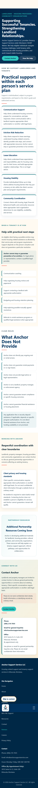
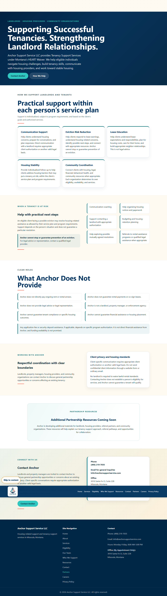

# Anchor Intake and Partners Release Review

**Branch:** `phase2/partners`  
**Target:** `main`  
**State:** Review-only Jotform embeds staged; no PR was created because the connected GitHub integration rejected PR creation with HTTP 403 (`Resource not accessible by integration`). Do not merge or deploy before administrator verification and owner approval.

## Integrated history

This branch preserves the current main baseline and prior work in its ancestry:

- `dee39e3` — current main baseline, including Careers/Indeed recruitment updates.
- `bf3afc0` — Phase 1 static-site modernization, allowlisted Pages publishing, and QA workflow.
- `4be833e` — Phase 2 intake reopening copy and telephone fallback, with unverified signing forms withheld.
- `db1ec4e` — Partners page, site navigation, sitemap, allowlist, and QA coverage.

No old intake-pause notice was restored. Careers and Indeed links and the deployment allowlist remain intact.

## Partners page

The `/partners/` route covers landlord and property-manager coordination, tenant communication and housing stability, eviction-risk coaching and referrals, legal/financial limits, confidentiality and authorization, existing contact information, and “Additional Partnership Resources Coming Soon.” It adds no form, client database, or backend. The contact path is the existing phone and general email, expressly for general partnership inquiries; confidential client details are not requested by ordinary email.

The page makes support conditional on eligibility, the client’s service plan, authorization, and program requirements. It does not promise eviction prevention, tenant compliance, rental payments, funding, placement, or service eligibility. It states that Anchor does not provide legal advice or representation and landlords need not waive lawful standards.

## Jotform readiness: blocked pending administrator verification

The two historical forms are:

1. **Anchor Medicaid Eligibility Consent**
2. **TSS PA / Referral Paperwork**

The owner supplied two invitation-path embed URLs and asked that they be staged for administrator review. They are kept inside inert HTML `<template>` elements on `/secure-paperwork.html`; browsers do not render those frames or request the URLs, and no active Jotform signing link is presented. Each template includes its supplied embed code and a full-screen link candidate. The visible page remains telephone-first, says the links are under review, and explicitly says Step 2 is not technically access-restricted while publicly embedded. The route remains `noindex, nofollow`.

Anonymous read-only checks of the supplied URLs returned HTTP 200 and the expected form titles at the time checked. The Step 1 document showed 47 controls and 14 non-empty fields; Step 2 showed 97 controls and 52 non-empty fields. **No field values were read, recorded, or submitted.** Because values are present in both sessions, we cannot determine whether they are benign document defaults or applicant-specific data. This is a release-blocking isolation/privacy concern until the administrator confirms the links create separate blank applicant sessions. These checks do not establish that the links were generated through Share → Embed, remain active, or route completed submissions to Anchor's intended account.

No authenticated Jotform administration access was available. No submissions were inspected or made. Online signing and the full-screen links remain inactive.

An authorized Jotform administrator must verify and document all of the following before enabling online paperwork:

1. In the live account, confirm both supplied URLs are current reusable public Share → Embed signing links and are not invitation-specific links. Explain the observed non-empty fields without exposing their values. Using synthetic data only, verify that separate fresh sessions are blank and isolated, and that no previous applicant's information is exposed. Confirm whether the full-screen URLs are the approved public sharing URLs.
2. Verify a current, executed HIPAA Business Associate Agreement applies to Anchor’s Jotform account, plan, forms, storage, and enabled features. Confirm which submissions and attachments it covers; do not infer coverage from a product label or a generic vendor statement.
3. Review submission privacy and separation: who can view, edit, export, download, or share each form’s responses; whether responses or attachments appear in public/shared locations; and whether access is limited to the correct authorized staff.
4. Review account access: current named staff, role permissions, authentication/MFA settings, former-staff access removal, and available access/audit history.
5. Review notifications and routing: send only minimum-necessary notifications, avoid PHI in ordinary email subjects/bodies and attachments, confirm recipients are authorized, and keep the consent and TSS PA workflows separate and correctly ordered.
6. Confirm retention, deletion, export/backups, and incident/escalation procedures for the submissions under Anchor’s applicable policies and agreements.
7. Test only with synthetic data after the account checks. Verify the links, separate sessions, notifications, routing, access, and deletion without entering or submitting actual client PHI.

Official Jotform guidance describes generating a Jotform Sign embed via **Share → Embed** and copying its generated embed code, but this does not verify that the supplied invitation-path URLs were generated that way or are reusable. Jotform's HIPAA help says account administrators must enable the HIPAA environment and review/sign the BAA in the account; Anchor's own configuration and signed BAA remain unverified ([Jotform Sign embed instructions](https://www.jotform.com/help/how-to-use-jotform-sign/), [HIPAA BAA instructions](https://www.jotform.com/help/501-how-to-receive-the-baa-for-my-hipaa-account/), [HIPAA environment setup](https://www.jotform.com/help/500-how-to-enable-hipaa-compliance/)).

Until administrator verification is complete, the public secure-paperwork route offers a clearly labeled **Call Anchor About Intake** telephone option. It shows no online application button, does not claim that online paperwork is active, and remains `noindex, nofollow`. The review branch is ready for telephone-based inquiries as a website flow; the live website has not been updated.

## Verification results

Ran the public-site builder and existing Playwright QA suite against `dist/public-site` after adding `/partners/` to the explicit allowlist.

- 60 page/viewport combinations across 360, 375, 390, 430, 768, 900, 1024, 1366, 1440, and 1920 px.
- No overflow, page errors, console errors, failed local requests, broken images, unresolved internal links, or automated accessibility smoke-test findings.
- Partners content/limitations/privacy/contact/no-form checks passed; route is in the sitemap, public allowlist, homepage callout, mobile navigation, desktop navigation, footer, Careers, Policy, secure-paperwork, and 404 navigation.
- Existing client-intake phone fallback, Careers/Indeed/PDF, Privacy Policy, contact links, and public WaiverTrack landing-route checks passed. WaiverTrack authentication was not opened or changed.
- The supplied embed snippets and full-screen link candidates are present only inside inert review templates; both form steps, order instructions, no-guarantee notice, phone option, and inactive state pass checks. No live Jotform request is made by the website, and no active Jotform link is rendered.
- Anonymous checks of the externally supplied Jotform URLs loaded the expected titles but showed non-empty fields. Applicant isolation, form status, destination account, notification contents/recipients, staff access, HIPAA environment, and BAA coverage cannot be verified without an authorized account administrator.
- No real client data was used; no Jotform was submitted.

### Screenshots

These review-only artifacts are outside the public-site allowlist and are not deployed.

## Release gate

**Telephone inquiry flow:** implemented and QA-passing in this branch; not live until the owner approves the PR and deployment.  
**Full online Jotform intake:** not ready. Reusable links and account/privacy controls remain unverified.  
**Production:** not ready and not deployed. Complete the Jotform administrator checklist, review the draft PR and CI results, obtain owner approval, and only then merge/deploy. After verified links are configured, rerun the full synthetic-data QA before enabling the forms.
